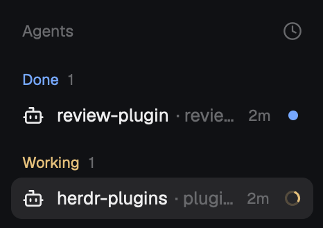
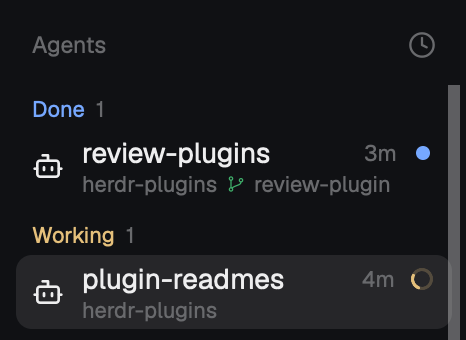

# agents-by-tab-name

This mod replaces the built-in `agents` list with a compact tab name, space, and
machine.

 

## Install

This mod requires the Herdr desktop app (tested with Herdr 0.1.16).

1. Copy or Link `agents-by-tab-name` into Herdr's mods folder
   (`~/.config/herdr-app/mods`):

   ```sh
   ./plugin.sh link agents-by-tab-name
   ```
   Keep the repository folder in place because Herdr's mods folder stores a symlink to
   it.

2. Add the mod to your custom layout. If you do not have a custom layout yet, clone
   `main`:

   ```sh
   herdr-app do layout.clone '{"name":"main","as":"my-layout"}'
   ```
  
   Find the block with `"id": "agents"`. Change its `content` field to load
   `agents-by-tab-name` instead:

   ```json
   "content": { "mod": "agents-by-tab-name" }
   ```

   Save the file. Herdr reloads the layout automatically.

3. Check that Herdr loads the mod without errors:

   ```sh
   herdr-app check ~/.config/herdr-app/mods/agents-by-tab-name    # prints "check passed"
   ```

## Notes

- Herdr does not watch files behind symlinks. Run
  `./plugin.sh reload agents-by-tab-name` after editing files or pulling updates.
