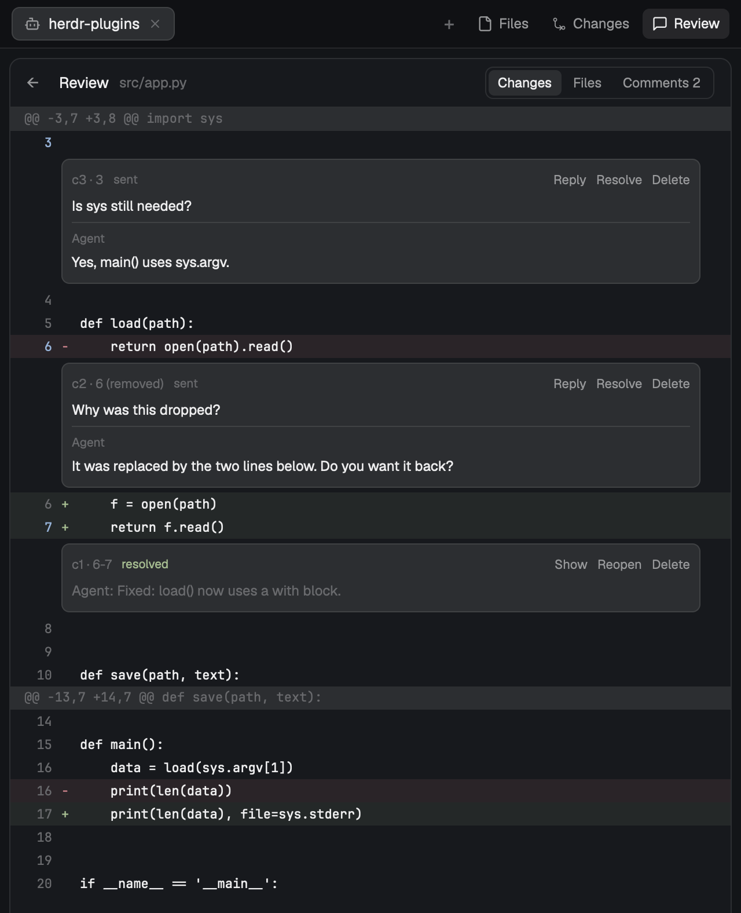
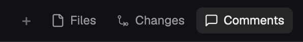

# review-panel

Provides an improved files panel that allows commenting on files and improves markdown
rendering.

- **Files:** Auto-saved local code editing (`Cmd-S` or blur flushes immediately),
  rendered markdown with local pictures and Mermaid diagrams, and a **Comment** toggle
  for inline threads.
- **Changes:** Syntax-colored diffs (**Preview / Diff** for markdown) and a bottom
  commit bar (`git add -A` + `git commit`).
- **Comments:** Click or drag lines or markdown blocks (`Cmd-Enter` to add), then
  **Submit review** to send all unsent comments to your agent via `hc send` and show its
  replies inline.



## Install

1. Make sure you have the Herdr desktop app (tested with 0.1.16) and `git` on tracked
   machines. For Mermaid diagrams, you also need Node.js on `PATH` and Chrome, Chromium,
   Edge, or Brave locally.

2. Link `review-panel` into Herdr's mods folder (`~/.config/herdr-app/mods`):

   ```sh
   ./plugin.sh link review-panel
   ```

   Keep this repo in place because Herdr's mods folder stores a symlink to it.

3. Optional — install the Mermaid diagram renderer (~180 MB; without it, markdown and
   pictures still render and Mermaid blocks stay as code):

   ```sh
   (cd ~/.config/herdr-app/mods/review-panel/renderer && npm install)
   ```

4. Add `review-panel` to your custom layout. If you don't have one yet, clone `main`:

   ```sh
   herdr-app do layout.clone '{"name":"main","as":"my-layout"}'
   ```

   In `~/.config/herdr-app/layouts/my-layout.json`, replace `panel-body`'s children with
   `review-panel`:

   ```json
   {
     "id": "panel-body",
     "type": "stack",
     "children": [
       { "id": "review-panel", "type": "block", "content": { "mod": "review-panel" } }
     ],
     "active": "review-panel"
   }
   ```

   Optional — to put **Files**, **Changes**, and **Comments** buttons in the top-right
   tab bar (otherwise the panel draws its own switcher), set the `"id": "tabs"` block
   to:

   ```json
   { "id": "tabs", "type": "block", "content": { "mod": "review-panel", "props": { "role": "tabs" } }, "size": { "px": 42 }, "window_drag": true }
   ```

   

   Save the file. Herdr reloads the layout automatically.

5. Check that Herdr loads the mod without errors:

   ```sh
   herdr-app check ~/.config/herdr-app/mods/review-panel    # prints "check passed"
   ```

## Notes

- Comment mode and diffs page every 300 rows (`↑` / `↓`); native **Edit** supports local
  files up to 1 MiB.
- Agent comments live in `<repo>/.herdr/review/<8-hex-key>/<id>.md`
- Each tab remembers the file it had open and the folders it had expanded in
  **Files**, and shows them again when you switch back or restart Herdr. **Files** and
  **Changes** share the open file: **Changes** shows its diff when the file has changes.
- With the review-panel tab bar, each tab also remembers whether the panel is open, its
  mode, and its width. A tab that you have not visited starts with the panel closed.
- Closed tabs keep comments for 30 days and reattach if a new tab gets the same custom
  name.
- Herdr does not watch files behind symlinks. Run `./plugin.sh reload review-panel`
  after editing files or pulling updates.
