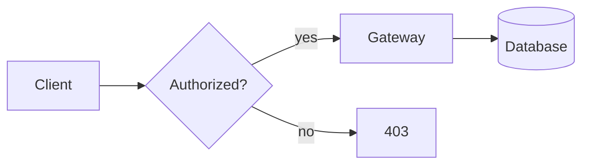
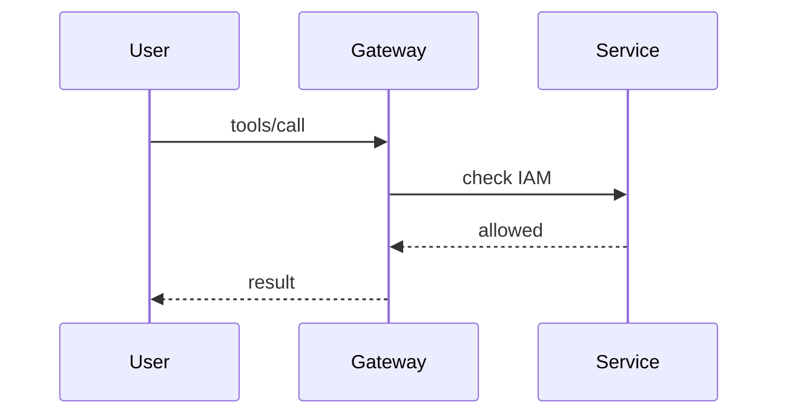
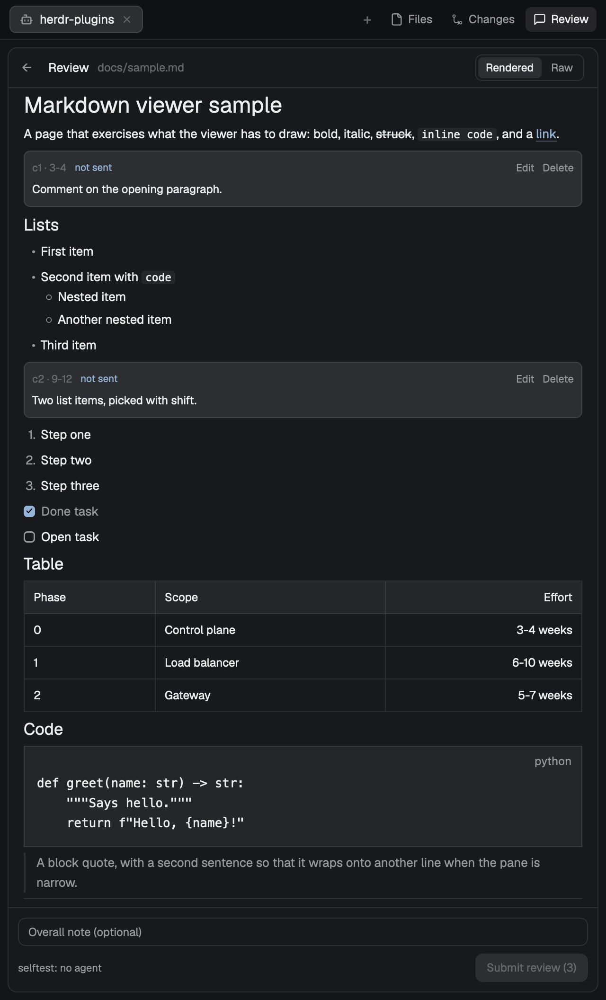

# Markdown viewer sample

A page that exercises what the viewer has to draw: **bold**, *italic*,
~~struck~~, `inline code`, and a [link](https://herdr.dev).

## Lists

- First item
- Second item with `code`
  - Nested item
  - Another nested item
- Third item

1. Step one
2. Step two
3. Step three

- [x] Done task
- [ ] Open task

## Table

| Phase | Scope | Effort |
| :--- | :--- | ---: |
| 0 | Control plane | 3-4 weeks |
| 1 | Load balancer | 6-10 weeks |
| 2 | Gateway | 5-7 weeks |

## Code

```python
def greet(name: str) -> str:
    """Says hello."""
    return f"Hello, {name}!"
```

> A block quote, with a second sentence so that it wraps onto another line
> when the pane is narrow.

---

## Flowchart



Text between two diagrams.

## Sequence diagram



## Picture



Text after the picture.

## A diagram with a mistake

```mermaid
flowchart LR
    A --> 
    B -->
```

The end.
