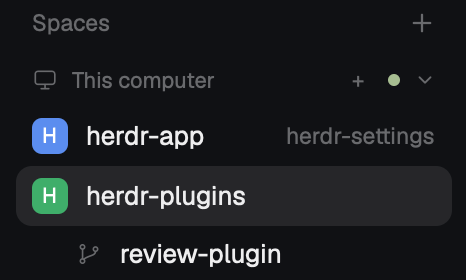
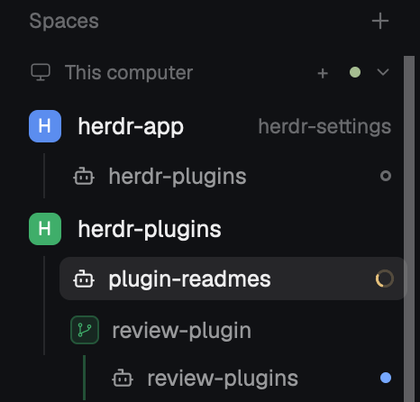

# spaces-tab-tree

Replaces Herdr's built-in `spaces` list so each space shows its tabs underneath, with repo-colored badges on git worktrees. Live subagents appear nested under their parent tab, where you can fold them or click a subagent to focus or peek at it. Hover a space to fold its tabs or open a new tab (`+`), and click, double-click, drag, or right-click tabs directly from the list.

 

## Install

This mod requires the Herdr desktop app (tested with Herdr 0.1.16).

1. Link `spaces-tab-tree` into Herdr's mods folder (`~/.config/herdr-app/mods`):

   ```sh
   ./plugin.sh link spaces-tab-tree
   ```

   Keep this repo in place because Herdr's mods folder stores a symlink to it.

2. Add the mod to your custom layout. If you don't have one yet, clone `main`:

   ```sh
   herdr-app do layout.clone '{"name":"main","as":"my-layout"}'
   ```

   In `~/.config/herdr-app/layouts/my-layout.json`, find the block with `"id": "spaces"` and point it to `spaces-tab-tree`:

   ```json
   "content": { "mod": "spaces-tab-tree" }
   ```

   Save the file. Herdr reloads the layout automatically.

3. Check that Herdr loads the mod without errors:

   ```sh
   herdr-app check ~/.config/herdr-app/mods/spaces-tab-tree    # prints "check passed"
   ```

## Notes

- Publishes worktree metadata under shared state key `spaces.worktrees`, which [agents-by-tab-name](../agents-by-tab-name/README.md) reads to badge worktree agents.
- Herdr does not watch files behind symlinks. Run `./plugin.sh reload spaces-tab-tree` after editing files or pulling updates.
